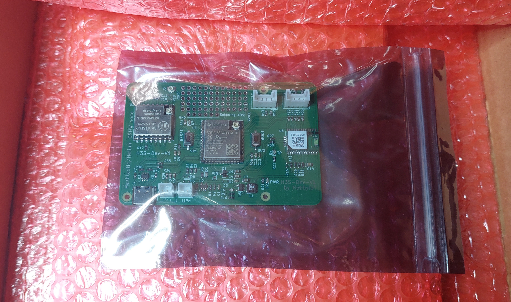
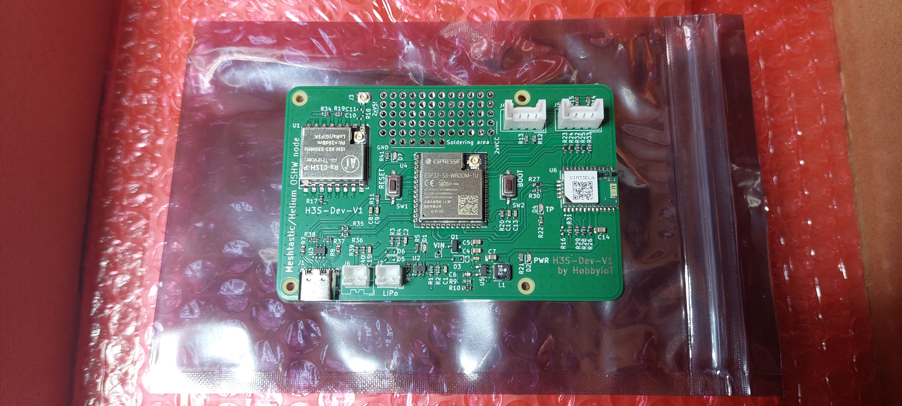
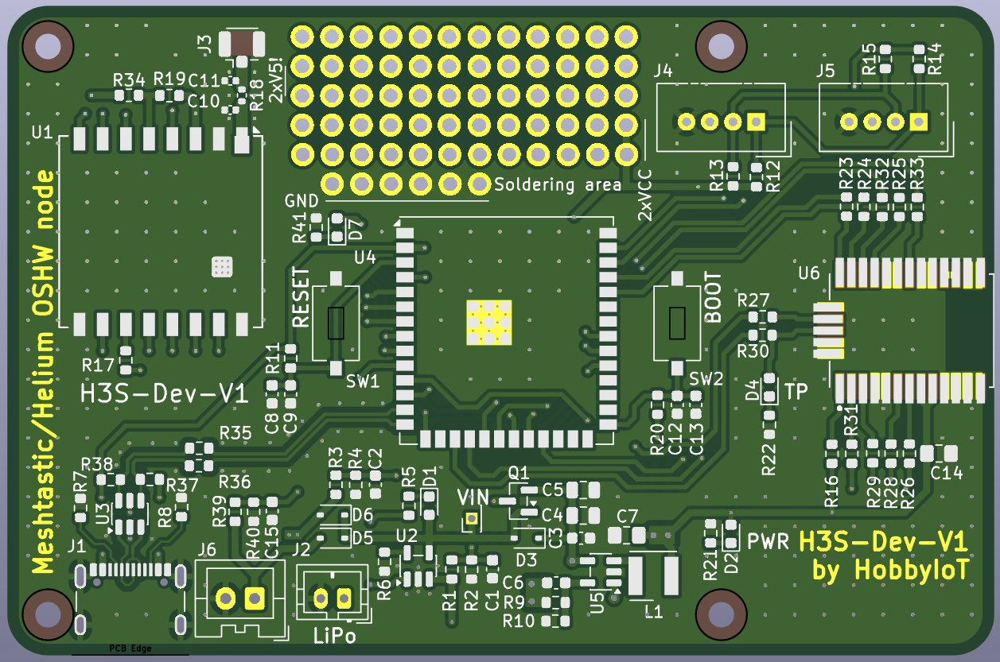
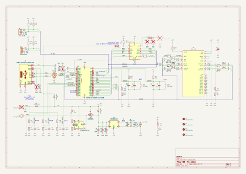

# H3S-Dev board for building Meshtastic nodes

### The new H3S-Dev design is alive!

#
## This project was sponsored by [PCBWay](https://www.pcbway.com/)
### They offer a turnkey service to manufacture and assemble your printed circuit boards! The whole operation is fast and reliable since every single step is agreed between the customer and the responsible people from the factory. Every one detail is discussed as the components and materials used are agreed on at a high professional level.

## Arrival and first impressions

All prototypes came as usual from that manufacturer - individually and safely packed within the parcel - directly from the factory!

H3S-Dev board     |  Unpacking
:-------------------------:|:-------------------------:
 | 

### 

#

### Specifications:
-  MCU:  ESP32-S3 with 8MB PSRAM
-  LoRa: RA-01SH-P with Power amplifier
-  GNSS: L96-M33 or similar
-  Power: USB-C and additional input (for example solar source) with separate sensing
-  LiPo battery management
-  I2C extension slots and soldering area
-  Credit card size 2-layer PCB
-  KiCad design open source hardware
#

### As a successor of our recent [H2S-Dev board](https://github.com/hobbyiot/LoRa-Nodes) the new hardware is compatible with both Meshtastic and Helium networks, ready to setup a simple node, sensor or tracker of your choice!

#

#
### H3S-Dev board Meshtastic implementation

[](https://github.com/hobbyiot/H3S-Dev-V1/releases/latest)

H3S-Dev runs the official [Meshtastic](https://meshtastic.org) firmware. Ready-to-flash binaries are on the [Releases](https://github.com/hobbyiot/H3S-Dev-V1/releases) page, and they follow the official Meshtastic releases: every new stable Meshtastic version is built and tested for H3S-Dev and published here.

| File | Use it for | Flash address |
|---|---|---|
| `firmware-h3s-dev-<version>.factory.bin` | First flash or full erase | `0x0` |
| `firmware-h3s-dev-<version>.bin` | OTA-style update (app only) | `0x10000` |

Flash with esptool v5 (the board uses native USB; hold BOOT while plugging in if the port does not appear):

```sh
# Full factory flash (erases everything)
esptool --chip esp32s3 --port /dev/ttyACM0 erase-flash
esptool --chip esp32s3 --port /dev/ttyACM0 write-flash 0x0 firmware-h3s-dev-<version>.factory.bin

# App-only update (keeps settings)
esptool --chip esp32s3 --port /dev/ttyACM0 write-flash 0x10000 firmware-h3s-dev-<version>.bin
```

GNSS support is planned for a future release. Build instructions and details: [Meshtastic/README.md](Meshtastic/README.md).

#
### Circuit schematic:
[](HW/H3S-Dev-V1/H3S-Dev-V1_Schematic.pdf)
